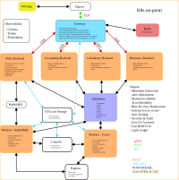

High-Load Medical System — Architecture Case Study

    Note: This repository contains the architectural documentation of a proprietary internal system. The source code is private. This case study outlines the challenges, design decisions, and system constraints of a production-grade Hospital Management System (HMS) built from scratch.

# Project Overview

A comprehensive, production-oriented internal server system designed for multi-hospital environments. The platform integrates patient records, pharmacy inventory, accounting, laboratory workflows, staff management, and audit logging into a unified, secure, and horizontally scalable architecture.

The system is built as a set of containerised "macroservices", microservices and dedicated domain databases, orchestrated via Kubernetes. It employs a strict separation of concerns:

    Go-based Gateway: Handles security, TLS termination, request throttling, RBAC, and in-memory caching.

    Rust-based Core: Manages business logic, custom database routing/sharding, and asynchronous task distribution via RabbitMQ.

    Dedicated Monoliths: Accounting and laboratory logic are separated into lightweight, on-demand services to optimize resource usage, as they do not require 24/7 uptime.

# Architecture Overview

# Database Strategy (Hybrid Sharding + Domain Isolation)

The system runs multiple separate PostgreSQL instances, divided into two distinct groups to balance scalability and ACID compliance:
Group	Count	Purpose	Routing Strategy
Patient Shards	4-16	Patient-centric data: hospitalizations, medical records, prescriptions, lab orders, treatment history.	Deterministic hashing of patient identifiers. Ensures all records for a single patient reside on the same shard for strict ACID compliance per patient.
Dedicated Domains	7	Independent modules: drugs/inventory, accounting/invoicing, staff/RBAC, audit, system logs, etc.	Static routing. Each domain knows its target database. No sharding logic; designed for stable data sets that do not scale linearly with patient count.

This hybrid approach provides linear write scalability for patient data (the primary bottleneck) while keeping financial and inventory logic safely isolated in their own ACID-compliant silos without the overhead of distributed transactions.
# Key Features & Engineering Decisions

    Custom Hash-based Sharding with Anchors: Deterministic patient ID distribution across PostgreSQL shards enables linear write scalability and fault isolation. Implemented entirely from scratch, featuring auto-resume, zero-downtime migration, and multi-check validation.

    Secure by Design: JWT-based auth, TLS termination, strict RBAC, Argon2 password hashing, honeypots, rate limiting, and input sanitization.

    Crypto-Shredding per Patient/User: Sensitive data is encrypted using AES standard. Per-patient/user AES keys allow for instant, provable right-to-erasure (RODO) without database performance penalties.

    Asynchronous Processing: RabbitMQ reliably decouples the core API from heavy background tasks, ensuring responsiveness under load.

    Type-Safe Inter-service Communication: Rust backend and workers share the exact same Serde serialization crates, ensuring flawless handling of byte payloads (Vec<u8>) from RabbitMQ.

    gRPC over UDS: Replaced REST/TCP with gRPC over Unix Domain Sockets for internal service communication, eliminating network stack overhead and simplifying intra-cluster security (no TLS cert management).

    WebAssembly (WASM) Integration: Custom Rust-to-WASM modules handle client-side serialization and validation of DataMatrix/EAN barcodes and medical code dictionaries (ICD-10/ICD-9). The search engine implements fuzzy matching (Jaro-Winkler) to tolerate typos and misspellings, enabling doctors to find diagnoses and procedures instantly without backend requests, even offline.

    Stateless Compute Tier: All durable state is persisted in PostgreSQL or Redis (session tokens only). The core compute tier is stateless and ready for horizontal scaling.

# Security Posture

    2FA for privileged roles.

    Crypto-shredding and per-patient/user AES keys.

    HMAC + pepper for hashing sensitive national IDs (PESEL).

    Comprehensive Audit Trail: Logging every user action and system event.

    Strict RBAC: Enforced at the Gateway level.

    UDS Security: Internal communication isolated via Unix Domain Sockets.

# Observability & Testing

    Observability: Prometheus, Grafana, and Tempo (OpenTelemetry). Distributed tracing and structured logging are implemented end-to-end.

    Testing: Unit tests, integration tests (testcontainers), and E2E sharding tests.

# Technology Stack & Rationale
Component	Technology
Frontend Gateway	Go (net/http, custom routing, middleware)
Core Backend API	Rust (Axum, Tokio, Serde, Tonic)
Background Workers	Rust (Tokio, Serde, RabbitMQ client)
Communication	TLS, UDS, REST, gRPC
Database	PostgreSQL, Redis
Message Broker	RabbitMQ
Orchestration	Kubernetes (k3d for dev, k3s for prod)
Frontend Assets	HTML5, CSS3, Vanilla JavaScript, WASM
Observability	OpenTelemetry, Tempo, Prometheus, Grafana
Why these languages?

    Rust: Chosen for the entire core backend. Zero GC, strict type safety, predictability, and memory safety. The compiler acts as a rigorous first line of defense.

    Go: Used for the edge/gateway layer. Lightweight, fast compilation, excellent for handling web traffic and goroutines.

    Plain JS: Used strictly for minimal frontend logic without heavy frameworks, reducing bundle size and avoiding framework bloat.

# Project Statistics

    ~134,000 lines of code (mixed languages). (state for 14/11/2026)

    Core Backend: ~45,000 lines of Rust.

    Gateway: ~24,000 lines of Go.

    Generated Data: ~26,000 lines of raw text data (medical code dictionaries) compiled into the system.

    WASM Modules: Custom medical code search engine handling ~10,000 procedures in ~1.7 MB, running entirely client-side.

# Deployment & Operations

    Current state: Deployed on K8s (k3s) with automated CI/CD pipelines, E2E testcontainers, and Blue-Green readiness.

    Planned scaling: Deploy RabbitMQ in clustered mode (HA) and implement Dead Letter Queues (DLQ) for robust error handling.

    CI/CD: CI with unit, integration, and E2E tests. Automated builds and rolling updates via K8s manifests.

Built for reliability, security, and scale. Designed with healthcare workflows and low-friction end-user experience in mind.
